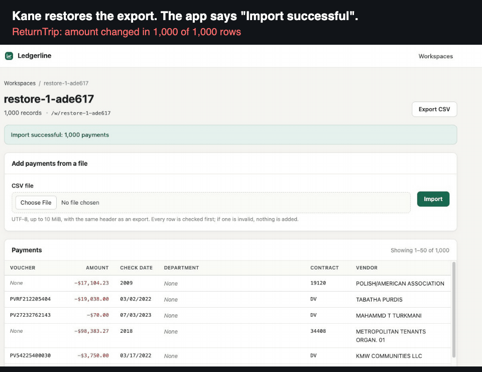

# ReturnTrip

**Prove your app gives back the data it exported.**



Your app says "Import successful". ReturnTrip checks whether the records that came back are the records that went out. [Kane CLI](https://github.com/LambdaTest/kane-cli) drives a real browser through export, restore into an empty workspace, and export again. ReturnTrip captures the real CSV bytes and compares every record against a trusted source. When something changed, it hands the evidence to Claude Code, which patches a disposable copy of your app. Then Kane runs the same journey again to prove the fix.

## Why

On 6 November 2026 the open-source finance app Sure merged [PR #4754](https://github.com/we-promise/sure/pull/4754):

> Re-importing Sure's own `transactions.csv` export flips every amount, so expenses come back as income and both legs of a transfer change direction.

Every step of that round trip looked fine. The export downloaded and the import said it worked. The data was wrong. Browser tests that check for a success message pass right through this kind of bug, and Kane's own triage can't settle it either. In our preflight, Kane labelled a real data mismatch as a `test_data_issue` with 0.96 confidence. Someone has to read the bytes.

## What happens in a run

1. **Source.** ReturnTrip starts a fresh copy of your app and loads a trusted source CSV through a seed command that never touches the importer under test.
2. **Export.** Kane opens the source workspace and clicks Export. A loopback proxy in front of the app records the downloaded file byte for byte and hashes it.
3. **Restore.** Kane creates a new, empty workspace and uploads that exact file through the app's file input. The proxy hashes the uploaded file part, and the run stops unless it equals the captured export.
4. **Re-export.** Kane exports the restored workspace, and the proxy captures it.
5. **Compare.** Every record is compared on three edges: source → export, export → re-export, and source → re-export. Values are compared as declared types (decimal, date, nullable string), so `19038` equals `19038.00`. Identical rows are kept as a multiset. No floats, no fuzzy matching, no model in the verdict.
6. **Repair** (optional). On a mismatch, Claude Code gets the comparison, sampled differences and Kane's own results. It runs headless in `--restricted` mode with only Read, Edit, Glob and Grep, inside a disposable copy. ReturnTrip checks what changed on disk against the allowed paths. It rejects edits to tests, fixtures, seed scripts, symlinks, mode changes and oversized diffs, then restarts the app on fresh data and has Kane run the identical journey again. Only that fresh, complete, equivalent comparison counts as fixed. You get a `.patch` to review. Nothing is merged or pushed.

## Results so far

All runs below are real: kane-cli 0.10.9 driving local Chrome, Claude Code 2.1.326, 1,000 City of Chicago payments.

| Run                           | What happened                                                                                                                                                                                                                                                                                                                                                           | Kane credits |     Time |
| ----------------------------- | ----------------------------------------------------------------------------------------------------------------------------------------------------------------------------------------------------------------------------------------------------------------------------------------------------------------------------------------------------------------------- | -----------: | -------: |
| Healthy round trip            | **VERIFIED**. 1,000 of 1,000 records identical on all three edges                                                                                                                                                                                                                                                                                                       |         76.1 |  5.5 min |
| Sign flip, repair (first try) | Detected: amount changed in 1,000 of 1,000 rows while every Kane step passed. Claude Code found the cause in 23 s for $0.21. The re-verification then failed on Kane's own checker (`assertion_error.step_not_achievable`, "a test-state detection problem"), so the run ended **EXECUTION_FAILED**, not fixed. That's why browser steps now retry once on fresh state. |        106.6 | 11.7 min |

More scenario results are added here as they are recorded. Misses and failures stay in the table.

## Install and run

Requires Node.js 24+, Chrome, and [Kane CLI](https://www.testmuai.com/support/docs/kane-cli-introduction/) signed in (`npm install -g @testmuai/kane-cli && kane-cli login --oauth`). Repair also needs [Claude Code](https://code.claude.com/docs/en/overview).

```sh
git clone https://github.com/winsznx/returntrip && cd returntrip
pnpm install
pnpm build
node apps/cli/bin/returntrip.js doctor --config examples/payment-roundtrip/returntrip.yaml
node apps/cli/bin/returntrip.js verify --config examples/payment-roundtrip/returntrip.yaml
```

A healthy run costs about 75 Kane credits. To watch the full loop, run a recreated defect in repair mode:

```sh
node apps/cli/bin/returntrip.js repair --config examples/payment-roundtrip/scenarios/sign-flip.yaml
```

Open the local dashboard with `node apps/cli/bin/returntrip.js ui --config examples/payment-roundtrip/returntrip.yaml --config examples/payment-roundtrip/scenarios/sign-flip.yaml`.

| Command                                                                    | What it does                                                                                  |
| -------------------------------------------------------------------------- | --------------------------------------------------------------------------------------------- |
| `doctor`                                                                   | Checks Node, Kane, credits, Claude Code and the config. Spends nothing.                       |
| `init --source data.csv --app-dir ./app`                                   | Writes a starter `returntrip.yaml` with the source pinned by sha256 and a suggested contract. |
| `verify`                                                                   | Export, restore, re-export, compare. Never edits code.                                        |
| `repair`                                                                   | Verify, then a bounded repair loop. Asks for consent first.                                   |
| `runs list`, `runs show <id>`, `report <id>`, `replay <id>`, `cancel <id>` | Inspect, export and replay stored runs.                                                       |
| `evidence export <id> --public`                                            | Writes a sanitized copy of a run for the public viewer.                                       |
| `ui`                                                                       | Loopback dashboard with live progress.                                                        |

Exit codes: `0` verified or repaired and verified, `2` data mismatch, `3` repair unresolved, `4` execution failed, `5` inconclusive, `6` invalid config, `7` budget exceeded, `130` canceled. `--json` prints one result on stdout, and `--events` streams NDJSON.

## How Kane CLI is used

| Step                | Kane feature                                                                                                                              | Where                                                                                                                                                        |
| ------------------- | ----------------------------------------------------------------------------------------------------------------------------------------- | ------------------------------------------------------------------------------------------------------------------------------------------------------------ |
| Every browser stage | `kane-cli run "<objective>" --agent`, parsed as NDJSON (`run_end` status, `reason_code`, `credits_consumed`, `context.memory` assertions) | [`packages/kane-adapter/src/run-objective.ts`](packages/kane-adapter/src/run-objective.ts), [`normalize-run.ts`](packages/kane-adapter/src/normalize-run.ts) |
| Restore             | Kane's native file upload into `<input type=file>`                                                                                        | objective text in [`examples/payment-roundtrip/returntrip.yaml`](examples/payment-roundtrip/returntrip.yaml)                                                 |
| Evidence            | Sealed evidence packs (screenshots per step, HAR, run log) kept with every run; screenshots feed the public viewer                        | [`packages/kane-adapter/src/evidence.ts`](packages/kane-adapter/src/evidence.ts)                                                                             |
| Closed loop         | Kane's stage results, assertions and failure summaries go into the repair request; Kane re-runs the identical journey on the patched app  | [`packages/orchestrator/src/repair-loop.ts`](packages/orchestrator/src/repair-loop.ts)                                                                       |
| Budget              | `credits_consumed` per stage, checked against a cap before each stage                                                                     | [`packages/orchestrator/src/context.ts`](packages/orchestrator/src/context.ts)                                                                               |

Kane's HAR records the export request but not its body, and the downloaded file doesn't land anywhere we can read reliably. So the bytes come from ReturnTrip's capture proxy, and Kane's evidence corroborates the timing and URL.

## Who decides what

Kane operates the browser and reports what it saw. Deterministic code decides whether the data is the same. Claude Code proposes a patch inside allowed paths. ReturnTrip validates the patch and re-verifies with Kane. You decide whether to apply the patch.

## Repository

| Path                                     | Purpose                                                                                          |
| ---------------------------------------- | ------------------------------------------------------------------------------------------------ |
| `apps/cli`                               | The `returntrip` command                                                                         |
| `apps/server`                            | Loopback API and SSE for the dashboard                                                           |
| `apps/demo-app`                          | Ledgerline, the payments app used as a controlled target, with five defect patches in `defects/` |
| `packages/orchestrator`                  | Run lifecycle, journey, bounded repair loop                                                      |
| `packages/kane-adapter`                  | Spawns Kane, parses NDJSON, reads evidence packs                                                 |
| `packages/artifact-capture`              | Reverse proxy that captures export bytes and hashes uploads                                      |
| `packages/csv-comparator`                | Strict CSV parsing and record comparison                                                         |
| `packages/repair-agent`                  | Restricted Claude Code invocation and patch policy                                               |
| `packages/target-runtime`                | Disposable app copies, lifecycle, argv-only execution                                            |
| `packages/storage`, `packages/reporting` | SQLite run store, artifacts, reports, public bundles                                             |
| `examples/payment-roundtrip`             | Real data, provenance, healthy and scenario configs                                              |

`pnpm test` runs the offline suite (no credits). `pnpm lint`, `pnpm typecheck` and `pnpm build` cover the rest.

## Limits

- It proves the declared fields survive one CSV export, restore and re-export on a test copy of your app. It doesn't certify backups or fields outside the contract.
- Kane uploads the restore file to TestMu AI cloud storage before setting it on the file input. Use public or test data.
- The defects in `apps/demo-app/defects` are recreated on a controlled demo app and labelled that way everywhere they appear. They are not a blind benchmark.
- Tested on macOS (arm64) with Node 24 and Chrome. Linux should work and runs in CI for the offline suite. Windows is untested.
- Repair needs a target ReturnTrip can start itself (`application.mode: managed`). Attached targets are verify-only.

## Data

City of Chicago, [Payments (s4vu-giwb)](https://data.cityofchicago.org/Administration-Finance/Payments/s4vu-giwb): 1,000 payments from the first page of the official API (9 November 2026). [`prepare-source.ts`](examples/payment-roundtrip/scripts/prepare-source.ts) rebuilds `source.csv` and records the hashes in [`provenance.json`](examples/payment-roundtrip/provenance.json).

> This site provides applications using data that has been modified for use from its original source, www.cityofchicago.org, the official website of the City of Chicago. The City of Chicago makes no claims as to the content, accuracy, timeliness, or completeness of any of the data provided at this site. The data provided at this site is subject to change at any time. It is understood that the data provided at this site is being used at one's own risk.

## Built with

TypeScript on Node 24, pnpm workspaces, Fastify, React, node:sqlite, Vitest and Biome. Built with Claude Code. Verified with Kane CLI.

MIT licensed. See [LICENSE](LICENSE).
